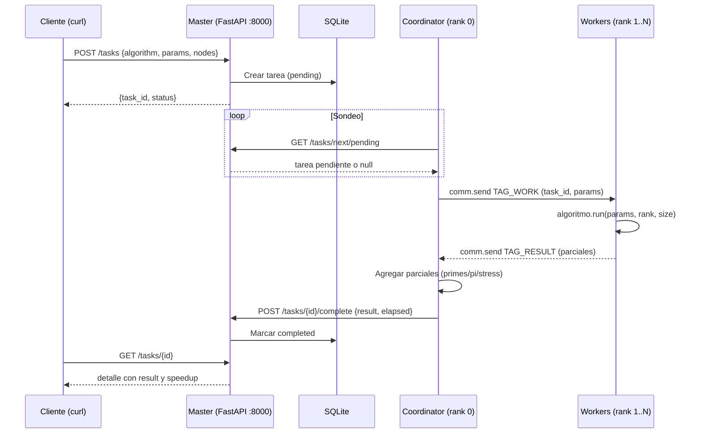
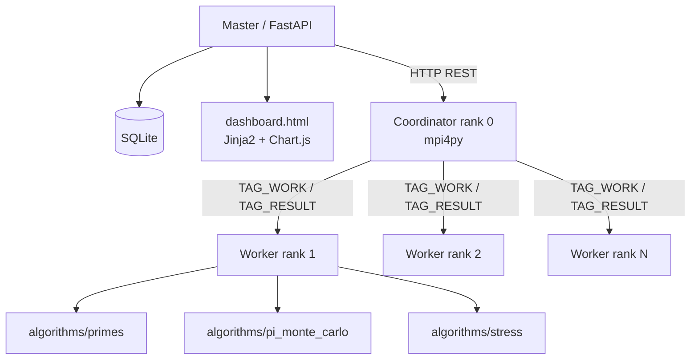

# python-mpi — MPI Job Runner

Sistema de cola de tareas distribuidas con MPI y dashboard web. Laboratorio educativo y práctico de cómputo distribuido: permite encolar tareas de cómputo intensivo vía API REST, ejecutarlas en paralelo con MPI y monitorear progreso desde un dashboard web con gráficos de speedup.

[](https://python.org)
[](https://mpi4py.readthedocs.io/)
[](https://fastapi.tiangolo.com/)
[](LICENSE)
[](https://github.com/bi0punk/python-mpi/actions)

## Contenido

- [Características](#características)
- [Arquitectura](#arquitectura)
- [Stack](#stack)
- [Estructura del repositorio](#estructura-del-repositorio)
- [Instalación](#instalación)
- [Uso](#uso)
- [Configuración](#configuración)
- [Tests / CI](#tests--ci)
- [Roadmap](#roadmap)
- [Licencia](#licencia)

## Características

- **Cola de tareas distribuidas**: encola tareas vía REST, ejecuta con MPI.
- **Dashboard web**: monitoreo en tiempo real con Chart.js (speedup, estado).
- **Algoritmos paralelizados**: `primes`, `pi_monte_carlo`, `stress`.
- **Comparación de rendimiento**: speedup single vs. distribuido.
- **Extensible**: arquitectura plugin para agregar algoritmos fácilmente.
- **Hostfile MPI**: soporte multi-nodo con `machines`.

## Arquitectura





## Stack

| Componente | Tecnología |
|---|---|
| Master / API | FastAPI + Uvicorn |
| Coordinación MPI | mpi4py |
| Dashboard | Jinja2 + Chart.js |
| Persistencia | SQLite |
| Workers | Python 3.10+ + MPI |
| Modelos | Pydantic |
| Tests | pytest, httpx, pytest-mock |

## Estructura del repositorio

```
python-mpi/
├── common/
│   ├── __init__.py
│   └── models.py            # Pydantic models
├── master/
│   ├── __init__.py
│   ├── app.py               # FastAPI + rutas
│   ├── db.py                # SQLite (tareas, workers)
│   └── templates/
│       └── dashboard.html   # Dashboard web con Chart.js
├── worker/
│   ├── __init__.py
│   ├── coordinator.py       # Rank 0: coordina workers
│   └── algorithms/
│       ├── __init__.py
│       ├── primes.py        # Conteo de primos
│       ├── pi_monte_carlo.py # Aproximación de Pi
│       └── stress.py        # Benchmark sintético
├── tests/
├── machines                 # Hostfile MPI
├── run.sh                   # Script para levantar todo
├── .env.example
├── .github/workflows/ci.yml
├── pyproject.toml
├── requirements.txt
└── README.md
```

### Componentes

| Componente | Rol | Tecnología |
|---|---|---|
| **Master** | Servidor web, recibe tareas y expone resultados | FastAPI + SQLite |
| **Coordinator** (rank 0) | Líder: consulta tareas pendientes, coordina workers, reporta resultados | mpi4py |
| **Compute** (rank 1..N) | Workers esclavos: ejecutan su chunk y devuelven resultado | mpi4py |
| **Dashboard** | UI web con estadísticas, speedup y tabla de tareas | Jinja2 + Chart.js |

## Instalación

Requisitos: Python 3.10+, OpenMPI o MPICH instalado en el sistema, mpi4py.

### Verificar MPI

```bash
# Linux
sudo apt install openmpi-bin openmpi-common libopenmpi-dev

# macOS
brew install open-mpi

# Verificar
mpirun --version
python -c "from mpi4py import MPI; print(f'{MPI.COMM_WORLD.Get_size()} processes available')"
```

Instalación del proyecto:

```bash
git clone https://github.com/bi0punk/python-mpi.git
cd python-mpi
python -m venv .venv
source .venv/bin/activate
pip install -r requirements.txt
```

## Uso

### 1. Iniciar el sistema

```bash
# Opción A: Script automático
chmod +x run.sh
./run.sh

# Opción B: Manual (dos terminales)
# Terminal 1 - Master
python -m master.app

# Terminal 2 - Workers (4 procesos)
mpirun -np 4 --hostfile machines python -m worker.coordinator
```

### 2. Crear tareas vía API

```bash
# Primos hasta 100,000
curl -X POST http://localhost:8000/tasks \
  -H "Content-Type: application/json" \
  -d '{"algorithm": "primes", "params": {"limit": 100000}, "nodes": 4}'

# Pi Monte Carlo con 10 millones de puntos
curl -X POST http://localhost:8000/tasks \
  -H "Content-Type: application/json" \
  -d '{"algorithm": "pi_monte_carlo", "params": {"points": 10000000}, "nodes": 4}'

# Stress test
curl -X POST http://localhost:8000/tasks \
  -H "Content-Type: application/json" \
  -d '{"algorithm": "stress", "params": {"iterations": 50000000}, "nodes": 4}'
```

### 3. Ver el dashboard

Abrir [http://localhost:8000](http://localhost:8000).

### Algoritmos incluidos

| Algoritmo | Descripción | Paralelización |
|---|---|---|
| `primes` | Cuenta primos hasta N | Cada worker revisa `N/size` números |
| `pi_monte_carlo` | Aproximación de Pi | Cada worker lanza `N/size` puntos |
| `stress` | Benchmark CPU (xor/shift) | Cada worker hace `N/size` iteraciones |

### API

| Método | Ruta | Descripción |
|---|---|---|
| `GET` | `/` | Dashboard web |
| `POST` | `/tasks` | Crear tarea |
| `GET` | `/tasks` | Listar tareas |
| `GET` | `/tasks/{id}` | Detalle de tarea |
| `GET` | `/tasks/next/pending` | Tarea pendiente para workers |
| `POST` | `/tasks/{id}/complete` | Reportar resultado completado |
| `POST` | `/tasks/{id}/fail` | Reportar fallo |
| `GET` | `/workers` | Workers conectados |
| `POST` | `/workers/ping` | Registro de worker por rank/host |

### Ejemplo de respuesta

```json
// POST /tasks
{ "task_id": 1, "status": "pending" }

// GET /tasks/1 (completada)
{
  "id": 1,
  "algorithm": "pi_monte_carlo",
  "params": {"points": 10000000},
  "nodes": 4,
  "status": "completed",
  "result": {
    "pi_approx": 3.141592,
    "total_points": 10000000,
    "workers": [...],
    "speedup": 1.0
  },
  "elapsed": 0.4231,
  "created_at": "2025-05-22T12:00:00+00:00",
  "completed_at": "2025-05-22T12:00:01+00:00"
}
```

### Cómo agregar un nuevo algoritmo

1. Crear `worker/algorithms/mi_algoritmo.py`.
2. Implementar función `run(params, rank, size) -> dict`.
3. Registrar en `worker/coordinator.py` en el diccionario `ALGORITHMS`.

```python
# worker/algorithms/sum_squares.py
def run(params, rank, size):
    n = params.get("n", 1000)
    chunk = n // size
    start = rank * chunk
    end = n if rank == size - 1 else (rank + 1) * chunk
    total = sum(i * i for i in range(start, end))
    return {"partial_sum": total, "start": start, "end": end}
```

## Configuración

Variables de entorno (ver `.env.example`):

| Variable | Default | Descripción |
|---|---|---|
| `MASTER_HOST` | `0.0.0.0` | Host del servidor master |
| `MASTER_PORT` | `8000` | Puerto del servidor master |

## Tests / CI

```bash
pip install pytest
pytest tests/ -v
```

El workflow `.github/workflows/ci.yml` ejecuta lint (Ruff) y tests (pytest) en cada push/PR.

## Roadmap

- [x] Cola de tareas distribuidas con MPI
- [x] Dashboard web con speedup
- [x] 3 algoritmos de ejemplo
- [ ] Prioridades en cola de tareas
- [ ] Cancelación de tareas en ejecución
- [ ] Re-ejecución automática de tareas fallidas
- [ ] Baseline secuencial real para calcular speedup
- [ ] Soporte GPU (CUDA + MPI)
- [ ] Escalado dinámico de workers
- [ ] Autenticación en API

## Licencia

MIT